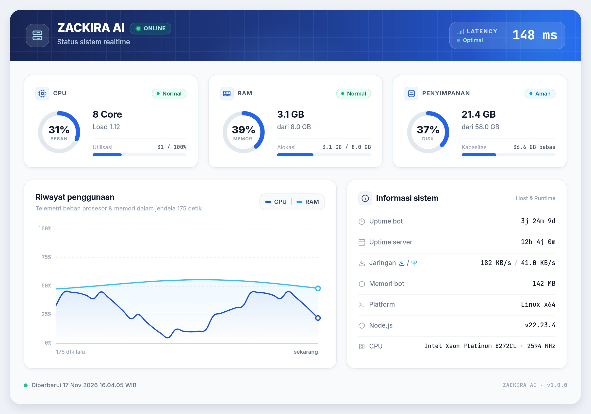

<!--
  ZACKIRA AI - WhatsApp bot with AI, made by ZACK
  (c) 2026 ZACK. Free and open source.

  Don't sell this script or re-upload it without my permission.
  If you modify or share it, keep this header and credit me as the original author.
  Please don't remove or change the watermark.
-->

<div align="center">

# ZACKIRA AI

**Bot WhatsApp Modern, Dibuat Oleh ZACK**

Bot WhatsApp yang jalan di atas [Baileys](https://github.com/WhiskeySockets/Baileys) dan [Groq](https://groq.com). Bisa diajak ngobrol biasa, kirim lagu atau video, cari dan bikin gambar, kirim pesan interaktif (tombol, list, carousel), sampai dipasang di nomor orang lain lewat fitur jadibot.


</div>

---

## Daftar Isi

1. [Fitur](#fitur)
2. [Yang dibutuhkan](#yang-dibutuhkan)
3. [Instalasi dan menjalankan](#instalasi-dan-menjalankan)
4. [Konfigurasi](#konfigurasi)
5. [Daftar command](#daftar-command)
6. [Menu, grup, owner, dan premium](#menu-grup-owner-dan-premium)
7. [Jadibot dan variabel custom](#jadibot-dan-variabel-custom)
8. [Cara kerja AI dan tools](#cara-kerja-ai-dan-tools)
9. [Panduan edit](#panduan-edit)
10. [Deploy](#deploy)
11. [Struktur folder](#struktur-folder)
12. [Troubleshooting](#troubleshooting)
13. [Keamanan](#keamanan)
14. [Lisensi dan watermark](#lisensi-dan-watermark)

---

## Fitur

| Kategori | Isi |
| --- | --- |
| Obrolan AI | Balasan natural pakai Groq. Model otomatis diganti kalau kena limit, dan bisa baca gambar |
| Riwayat per chat | Riwayat dipisah per nomor (private) dan per grup, jadi nggak bakal campur |
| Media | Kirim lagu (mp3/m4a) dan video YouTube lewat `yt-dlp`, cari link Spotify, TikTok, Instagram, dan web yang masih hidup |
| Gambar | Cari gambar (Pinterest, cadangan Bing), bikin gambar lewat kode canvas, gambar realistis lewat Cloudflare Workers AI, dan ubah daftar atau tabel jadi gambar |
| Pesan interaktif | Tombol, list pilihan, carousel, lokasi, tabel, dan code block native WhatsApp |
| Menu | `.menu` berupa tombol list berkategori, ada tombol link ke owner dan website |
| Fitur grup | Kick, add, tagall, antilink, antiswgroup, antipromosi, welcome, goodbye, dan lainnya (khusus premium dan owner) |
| Premium | Daftar user premium diatur owner lewat `.addprem` dan `.delprem` |
| Jadibot | Nomor lain bisa ikut jadi bot, bisa disewa lewat QRIS, datanya dipisah per nomor |
| Struk | Setelah sewa lunas, bot kirim struk berupa gambar |
| Auto AI | AI bisa dimatikan atau dinyalakan lewat `.autoai` |
| Anti-call | Telepon masuk otomatis ditolak dan penelepon diblokir |
| Auto-read | Pesan dibaca seperti orang yang lagi buka WhatsApp |
| Hemat limit Groq | Tool dipilih per pesan, daftar model dipisah untuk obrolan, tool, dan kode, plus cadangan Cloudflare |

---

## Yang dibutuhkan

- Node.js 22.13 atau lebih baru. Ini wajib karena `draw_image` pakai Node permission model
- npm
- Satu nomor WhatsApp buat bot (sebaiknya bukan nomor utama kamu)
- API key Groq (gratis): https://console.groq.com
- Opsional: akun Cloudflare (gambar realistis dan cadangan chat), `ffmpeg` (biar lagu jadi mp3), MongoDB Atlas (simpan sesi dan data sewa di hosting tanpa disk), akun SyahPay (kalau mau buka sewa jadibot)

---

## Instalasi dan menjalankan

### 1. Clone dan install

```bash
git clone https://github.com/USERNAME/REPO.git
cd REPO
npm install
```

Ganti `USERNAME/REPO` dengan alamat repo kamu. Kalau pakai Termux, install dulu `nodejs-lts` dan `git` lewat `pkg install`.

### 2. Bikin file `.env`

```bash
cp .env.example .env
```

Isi yang minimal saja:

```env
GROQ_API_KEY=gsk_xxxxxxxxxxxxxxxx
OWNER_NUMBERS=628111111111
PAIRING_NUMBER=628222222222
```

- `OWNER_NUMBERS`: nomor kamu sebagai owner. Formatnya `628xxxxxxxxxx` tanpa `+` dan spasi. Kalau lebih dari satu, pisahkan dengan koma.
- `PAIRING_NUMBER`: nomor WhatsApp yang mau dijadikan bot. Kalau dikosongkan, bot nanya lewat terminal.

### 3. Jalankan

```bash
npm start
```

Jalankan dari dalam folder project, soalnya `.env` dan folder `database/` dicari dari folder tempat bot dijalankan.

### 4. Pairing

1. Setelah start, terminal nampilin kode pairing 8 karakter.
2. Di HP bot, buka WhatsApp, lalu Perangkat Tertaut, lalu Tautkan dengan nomor telepon, dan masukkan kodenya.
3. Kalau sudah nyambung, muncul pesan berhasil terhubung di terminal.

Sesinya disimpan di folder `session/`, jadi nggak perlu pairing ulang tiap bot dijalankan lagi.

### Biar jalan terus (opsional)

```bash
npm install -g pm2
pm2 start index.js --name zackira-ai
pm2 logs zackira-ai
```

---

## Konfigurasi

Semua pengaturan dibaca dari `.env` (salinan dari `.env.example`) atau bisa diatur langsung di `variabel.js`. Kalau dua-duanya diisi, yang dipakai `.env`.

### Environment variable

| Variable | Wajib | Fungsi |
| --- | :---: | --- |
| `GROQ_API_KEY` | ya | API key Groq. Kalau kosong, AI nggak aktif |
| `OWNER_NUMBERS` | ya | Nomor owner, pisahkan dengan koma |
| `PAIRING_NUMBER` | tidak | Nomor bot untuk pairing. Wajib kalau hosting kamu nggak punya terminal interaktif |
| `BOT_PREFIX` | tidak | Tanda command, bawaannya `.` |
| `BOT_WEBSITE` | tidak | Link tombol Website di `.menu`. Di bot utama bawaannya `https://zackofficialdev.my.id` Di jadibot tombolnya muncul kalau ini diisi |
| `PREMIUM_TOOLS` | tidak | Daftar tool AI yang khusus premium, contoh `generate_image,draw_image`. Kosong berarti nggak ada |
| `SESSION_DIR` | tidak | Folder sesi WhatsApp, bawaannya `session` |
| `MONGODB_URI` | tidak | Simpan sesi dan data sewa di MongoDB (buat hosting tanpa disk permanen) |
| `MONGODB_DB`, `MONGODB_COLLECTION` | tidak | Nama database dan koleksi MongoDB |
| `YTDLP_COOKIES` | tidak | Path file `cookies.txt` YouTube, buat ngatasin blokir "confirm you're not a bot" |
| `YTDLP_PATH` | tidak | Path binary `yt-dlp` kalau kamu punya sendiri |
| `MAX_MEDIA_MINUTES` | tidak | Batas durasi media, bawaannya 15 |
| `MAX_MEDIA_MB` | tidak | Batas ukuran media, bawaannya 45 |
| `AI_HISTORY` | tidak | Jumlah pesan riwayat yang dikirim ke AI, bawaannya 10 |
| `RICH_MARKDOWN` | tidak | `true` supaya `**tebal**` tetap dipertahankan di pesan rich |
| `RICH_TABLE` | tidak | `false` untuk mematikan tabel native (tabel dikirim sebagai teks) |
| `CF_ACCOUNT_ID`, `CF_API_TOKEN` | tidak | Aktifkan Cloudflare Workers AI (gambar realistis dan cadangan chat) |
| `CF_IMAGE_MODEL` | tidak | Bawaannya `@cf/black-forest-labs/flux-1-schnell` |
| `CF_IMAGE_STEPS` | tidak | Langkah generate gambar (1 sampai 8), bawaannya 6 |
| `CF_CHAT_MODEL` | tidak | Model teks cadangan, bawaannya `@cf/meta/llama-3.1-8b-instruct` |
| `CF_CHAT_FALLBACK` | tidak | `false` untuk mematikan cadangan chat Cloudflare |
| `PORT`, `KEEPALIVE_URL`, `RENDER_EXTERNAL_URL` | tidak | Server HTTP kecil biar hosting gratis nggak tidur |

Variable khusus jadibot ada di [bagian jadibot](#pengaturan-env-jadibot).

### Pengaturan di `variabel.js`

| Variabel | Fungsi |
| --- | --- |
| `global.botname` | Nama bot (tampil di menu) |
| `global.botVersion` | Versi bot |
| `global.botAuthor` | Nama pembuat (footer menu) |
| `global.ownerNumbers` | Nomor owner (bawaannya dari `OWNER_NUMBERS`) |
| `global.prefix` | Tanda command |
| `global.groqModels` | Model untuk permintaan yang pakai tool, urut dari prioritas |
| `global.groqChatModels` | Model untuk obrolan biasa |
| `global.groqCodeModels` | Model untuk nulis kode gambar |
| `global.groqVisionModels` | Model yang bisa baca gambar |
| `global.maxMediaMinutes`, `global.maxMediaMB` | Batas media |

Penting: nilai bawaan `OWNER_NUMBERS` di `variabel.js` itu nomor milik pembuat. Ganti lewat `.env` atau langsung di file, kalau nggak command owner bisa dipakai orang lain.

---

## Daftar command

Prefix bawaannya `.` dan bisa diganti. Ketik `.menu` buat lihat semuanya lewat tombol.

### Umum dan pengaturan

| Command | Akses | Fungsi |
| --- | --- | --- |
| `.menu [kategori\|all]` | Semua | Menu utama berupa tombol list. Bisa juga langsung `.menu grup`, `.menu owner`, dan seterusnya |
| `.help` | Semua | Daftar command versi teks |
| `.ping` | Semua | Status sistem realtime berupa gambar: latency, CPU, RAM, penyimpanan, grafik, jaringan, uptime |
| `.owner` | Semua | Info owner (foto profil, nomor, bio) plus tombol chat langsung ke owner |
| `.cekprem` | Semua | Cek status premium kamu |
| `.jadibot` | Semua (chat pribadi) | Sewa jadibot dan pairing nomormu, lihat [bagian jadibot](#jadibot-dan-variabel-custom) |
| `.mode [all\|private\|group]` | Owner | Atur AI bales di private, grup, atau dua-duanya (bawaannya `private`) |
| `.modebot [all\|private\|group]` | Owner | Atur command bot aktif di private, grup, atau dua-duanya |
| `.autoai [on\|off]` | Owner | Nyalain atau matiin balasan otomatis AI. Command tetap jalan. Ada tombolnya juga |
| `.autoread [on\|off]` | Owner | Bot nandain pesan masuk sudah dibaca, dengan jeda acak 0,8 sampai 4 detik |
| `.anticall [on\|off]` | Owner | Telepon masuk ditolak dan penelepon diblokir (owner nggak ikut diblokir) |
| `.clearchat` | Owner | Hapus riwayat AI lewat tombol list: chat ini, semua private, semua grup, semua, atau satu chat tertentu |
| `.varcustom` | Owner | Atur variabel bot sendiri (nama, prefix, persona, dan lainnya) |

Pengaturan `.mode`, `.modebot`, `.autoai`, `.anticall`, dan `.autoread` disimpan di `database/settings.json`, jadi tetap berlaku setelah restart. Kalau belum pernah ada yang diubah, filenya memang belum ada.

Contoh hasil `.ping` (gambarnya dibuat langsung dari data server pas command dijalankan):

<p align="center"></p>

Selain command, semua pesan biasa dijawab AI sesuai `.mode` (kecuali kamu matikan lewat `.autoai off`). Contoh yang bisa diminta ke AI:

- "kirimin lagu Sheila On 7 Dan"
- "cariin link spotify lagu Dewa 19 Kangen"
- "carikan gambar anime keren di pinterest"
- "buatkan gambar kucing astronot" (butuh Cloudflare kalau mau hasil realistis)
- "kasih langkah logout email dalam bentuk gambar"
- "kirim tombol pilihan A dan B"

---

## Menu, grup, owner, dan premium

### Tampilan `.menu`

`.menu` ngirim satu pesan dengan tombol **Tap Disini!**. Kalau diketuk, muncul tiga pilihan: **DAFTAR MENU**, **Website**, dan **Kontak Owner**. Isi DAFTAR MENU dibagi dua:

- **INFORMATION**: Owner dan ALL MENU
- **PILIH KATEGORI MENU**: Menu Umum, Menu Grup, Menu Owner, dan Menu Jadibot (Menu Jadibot cuma muncul di bot utama)

Waktu salah satu kategori dipilih, bot kirim daftar commandnya dalam kotak bergaya `╭─◢◤ ... ╰───⧉`. Yang panjang dipecah per halaman, dan halaman berikutnya baru dikirim kalau tombol **Halaman berikutnya** ditekan, jadi nggak spam. Setiap pesan juga punya tombol **Kembali ke Menu**. Yang tampil cuma nama command, tanpa deskripsi.

Tampilan menu ini hanya soal teks dan tombol. Kalau mau ubah, semuanya ada di `commands/menu.js`.

### Perintah grup

Semua perintah grup khusus **premium dan owner**. Untuk perintah admin, yang pakai juga harus admin grup (owner dikecualikan) dan bot harus dijadikan admin dulu. Di jadibot, semua orang dianggap punya akses premium.

| Command | Fungsi |
| --- | --- |
| `.group open/close` | Buka atau tutup chat grup |
| `.kick @tag`, `.add 628xxx` | Keluarkan atau tambah anggota |
| `.promote @tag`, `.demote @tag` | Jadikan atau turunkan admin |
| `.tagall [pesan]`, `.hidetag pesan` | Tag semua anggota |
| `.linkgc`, `.revoke` | Ambil atau reset link grup |
| `.setnamegc`, `.setdesc` | Ganti nama atau deskripsi grup |
| `.del` | Hapus pesan yang dibalas |
| `.infogc`, `.listadmin` | Info grup dan daftar admin |
| `.antilink on/all/kick/off` | Hapus link grup atau channel WhatsApp. `all` untuk semua link, `kick` untuk hapus sekaligus keluarkan |
| `.antiswgroup on/kick/off` | Hapus pesan status yang nandain grup |
| `.antipromosi on/kick/off` | Hapus pesan promosi atau iklan (deteksinya pakai kata kunci, jadi bisa meleset) |
| `.welcome on/off`, `.goodbye on/off` | Sambutan buat anggota masuk dan keluar |

Admin grup dan owner nggak kena filter anti. Filternya cuma jalan kalau bot jadi admin grup. Yang dikunci untuk premium itu perintah buat ngatur filter, sedangkan filter yang sudah nyala tetap jalan buat semua anggota. Pengaturannya disimpan per grup dan per nomor bot di `database/groups.json`.

### Perintah owner

| Command | Fungsi |
| --- | --- |
| `.broadcast gc/pv/all pesan` | Kirim pesan ke semua grup atau chat pribadi |
| `.listgc`, `.leave`, `.join link` | Kelola grup tempat bot berada |
| `.ban`, `.unban`, `.listban` | Bot bakal cuekin user yang di-ban |
| `.block`, `.unblock` | Blokir atau buka blokir nomor di WhatsApp |
| `.addprem 628xxx hari` | Tambah user premium |
| `.delprem 628xxx`, `.listprem` | Hapus premium dan lihat daftarnya (nggak ngaruh ke sewa jadibot) |

### Premium

Premium itu terpisah dari jadibot. Premium ngasih akses ke fitur premium di bot utama, yaitu perintah yang bertanda `premiumOnly: true` (semua perintah grup sudah begitu) dan tool AI yang kamu daftarkan di `PREMIUM_TOOLS`. Premium nggak ngasih hak sewa jadibot.

Sebaliknya, orang yang sewa jadibot bisa pakai bot di nomornya dengan semua fitur terbuka, termasuk fitur premium, kecuali perintah jadibot dan premium yang memang cuma ada di bot utama. Data premium disimpan bareng data sewa (MongoDB atau file lokal).

### Struk pembayaran

Setiap sewa jadibot yang lunas otomatis dikirimi struk gambar bergaya thermal, desainnya sama dengan struk di zackuplay. Isinya nomor invoice, paket, biaya layanan, total, dan metode QRIS.

---

## Jadibot dan variabel custom

Nomor lain bisa ikut jadi bot dengan sistem yang sama, cukup lewat satu command.

### Cara pasang (buat pengguna)

1. Kirim `.jadibot` ke bot utama lewat chat pribadi.
2. Bot bales dengan petunjuk dan kode pairing 8 karakter (berlaku 2 menit).
3. Di HP nomor itu: WhatsApp, Perangkat tertaut, Tautkan perangkat, Tautkan dengan nomor telepon saja, lalu masukkan kodenya.
4. Selesai. Nomor itu sekarang dibales bot, dan bot utama kirim konfirmasi.

Kalau nomornya nggak kebaca otomatis (JID `@lid`), kirim `.jadibot 628xxxxxxxxxx`.

| Command | Keterangan |
| --- | --- |
| `.jadibot` | Minta kode pairing buat nomormu |
| `.jadibot stop` | Hentikan dan logout bot nomormu. Semua datanya ikut dihapus |
| `.jadibot list` | Daftar jadibot yang aktif (khusus owner bot utama) |
| `.varcustom` | Lihat variabel dan cara pakainya |
| `.varcustom botname=Nama` | Ubah variabel. Banyak sekaligus juga bisa, satu per baris |
| `.varcustom reset [nama]` | Kembalikan ke bawaan |

Variabel yang tersedia: `botname`, `prefix`, `author`, `owner` (nomor tambahan, pisah koma), `groqkey` (API key Groq sendiri), dan `persona` (gaya bicara AI, maksimal 500 huruf).

Jadibot nggak bisa mengakses fitur jadibot itu sendiri. Artinya sub bot nggak bisa bikin nomor lain jadi sub bot, dan perintahnya juga nggak muncul di menu mereka. Pesan konfirmasi yang dikirim bot utama juga diabaikan sub bot dan AI-nya, supaya nggak saling balas.

### Sewa jadibot (berbayar, QRIS)

Bawaannya jadibot itu berbayar: Rp 1.000 per hari, bayar lewat QRIS (SyahPay). Owner bot utama nggak perlu bayar.

Alurnya:

1. Kirim `.jadibot` ke bot utama (chat pribadi), lalu pilih paket lewat tombol list: 1 hari, 3 hari, 1 minggu, 2 minggu, 1 bulan, 3 bulan, 6 bulan, atau 1 tahun.
2. Bot kirim gambar QRIS lengkap dengan total bayar dan batas waktunya. Scan pakai e-wallet atau m-banking.
3. Pembayaran dicek otomatis tiap beberapa detik (bisa juga tekan Cek Pembayaran). Begitu lunas, bot bales konfirmasi, kirim struk, dan langsung kirim kode pairing.
4. Satu hari dan tiga jam sebelum habis, bot kirim pengingat.
5. Kalau masa sewa habis, bot utama kirim pemberitahuan, lalu menghapus sesi dan logout perangkat tertaut, jadi sub bot berhenti. Variabel dan riwayat nomor itu ikut terhapus.

| Command | Keterangan |
| --- | --- |
| `.jadibot` | Pilih paket (kalau belum sewa), atau minta kode pairing (kalau sewa masih aktif) |
| `.jadibot sewa [hari]` | Beli atau perpanjang sewa. Waktunya ditambah dari sisa masa aktif |
| `.jadibot cek`, `.jadibot batal` | Cek pembayaran, atau batalkan tagihan |
| `.jadibot status` | Lihat sisa sewa |
| `.jadibot give 628xxx 7` | Khusus owner: kasih sewa gratis (1 sampai 365 hari) |

Data sewa dan pesanan disimpan di MongoDB (koleksi `jadibot_rentals`, `jadibot_orders`, dan `jadibot_premium`) kalau `MONGODB_URI` diisi, jadi aman walaupun server atau disk direset. Kalau MongoDB nggak diatur atau nggak bisa dihubungi, bot pakai file lokal di `database/` (`jadibot_rentals.json`, `jadibot_orders.json`). Pas MongoDB pertama kali aktif, data lokal yang lama diimpor otomatis dan filenya diganti nama jadi `.migrated`.

Data sesi, variabel, dan riwayat tiap jadibot tetap berupa file di `database/jadibot/`. Pembayaran cuma dianggap sah kalau status invoice dari SyahPay `paid` dan nominalnya cocok dengan pesanan. Jadibot lama yang dipasang sebelum ada fitur sewa nggak punya batas waktu sampai kamu hentikan pakai `.jadibot stop`.

### Pengaturan `.env` jadibot

| Variabel | Keterangan |
| --- | --- |
| `JADIBOT_ENABLED` | `false` untuk mematikan fitur jadibot, bawaannya `true` |
| `JADIBOT_MAX` | Maksimal jadibot yang jalan bersamaan, bawaannya `10` |
| `JADIBOT_SHARE_KEY` | `true`: jadibot yang nggak punya `groqkey` pakai key bot utama (limitnya dipakai bareng). `false`: wajib isi `groqkey` sendiri |
| `JADIBOT_PAID` | `false` untuk menggratiskan jadibot, bawaannya `true` |
| `JADIBOT_PRICE_PER_DAY` | Harga per hari dalam rupiah, bawaannya `1000` |
| `JADIBOT_PLANS` | Daftar paket dalam hari, bawaannya `1,3,7,14,30,90,180,365` |
| `SYAHPAY_API_KEY` | API key dari dashboard SyahPay. Wajib supaya tagihan bisa dibuat |
| `SYAHPAY_BASE` | Base URL SyahPay, bawaannya `https://syahpay.biz.id` |

### Data dipisah per nomor

Tiap jadibot punya folder sendiri di `database/jadibot/<nomor>/` yang isinya `session/`, `vars.json`, `settings.json`, `chat_history/`, dan `user_profiles.json`. Variabel, mode, riwayat AI, profil, owner, dan prefix nomor A nggak akan tercampur dengan nomor B maupun bot utama. Limit Groq juga dihitung per API key.

Owner jadibot itu nomornya sendiri (ditambah variabel `owner`). Owner bot utama nggak otomatis bisa ngontrol jadibot. Pesan yang kamu ketik sendiri dari HP cuma diproses kalau itu di chat ke diri sendiri atau diawali prefix.

### Yang perlu diperhatikan

- Sesi jadibot disimpan sebagai file di server, jadi butuh penyimpanan permanen walaupun bot utama pakai MongoDB. Setelah restart, jadibot dipulihkan otomatis.
- `groqkey` disimpan apa adanya di `vars.json`. Hapus pesan yang berisi key setelah dikirim.
- Pemilik server secara teknis bisa mengakses sesi tiap jadibot. Bilang ini ke pengguna dan jangan disalahgunakan.
- Jangan pasang di nomor penting kalau belum paham risikonya (pesan dibales AI dan sesinya tertaut di server).
- Jadibot membalas semua orang yang chat ke nomornya sesuai `.mode` (bawaannya cuma private).

---

## Cara kerja AI dan tools

### Alur pesan

1. Pesan masuk lewat `index.js`. Kalau auto-read aktif, pesan ditandai dibaca.
2. Kalau diawali prefix dan dikenali, command dijalankan oleh `lib/commandHandler.js`.
3. Kalau bukan command (dan `.autoai` nggak dimatikan), pesan dikirim ke `plugins/zackAi.js`. Riwayat chat dimuat, tool dipilih sesuai isi pesan, lalu model Groq dipanggil dengan rotasi model.
4. Kalau model manggil tool, `plugins/tools.js` yang menjalankannya dan hasilnya dikembalikan ke model sampai jawaban akhir keluar.

### Tools yang bisa dipanggil AI

| Tool | Fungsi |
| --- | --- |
| `search_links` | Cari link valid (Spotify, TikTok, Instagram, web) |
| `search_youtube` | Cari video atau lagu YouTube |
| `send_youtube_audio`, `send_youtube_video` | Unduh dan kirim lagu atau video |
| `send_youtube_carousel` | Hasil YouTube sebagai carousel |
| `send_image` | Kirim gambar dari URL |
| `send_pinterest`, `search_pinterest` | Cari gambar (Pinterest, cadangan Bing) dan kirim sebagai carousel |
| `generate_image` | Gambar realistis lewat Cloudflare Workers AI (muncul kalau Cloudflare diaktifkan) |
| `draw_image` | AI nulis kode canvas, dijalankan di sandbox, hasilnya PNG |
| `send_list_image`, `send_table_image` | Daftar atau tabel jadi gambar infografis |
| `send_buttons` | Tombol: balasan cepat, buka link, salin, telepon |
| `send_list` | List pilihan (maksimal 10 baris) |
| `send_carousel` | Kartu geser 2 sampai 10 dengan gambar dan tombol |
| `send_location` | Pin lokasi |

Pas user nekan tombol atau milih baris, teks `id` atau `value`-nya masuk ke AI seperti pesan yang diketik. Chat yang nyebut kata "jadibot" nggak dibales AI, karena itu urusan command.

### Riwayat percakapan

Disimpan per chat, bukan per pengirim:

- Private: `database/chat_history/private/<nomor>.json`
- Grup: `database/chat_history/group/<id-grup>.json`

Di grup, tiap pesan diberi label `[Nama]:` supaya AI tahu siapa yang lagi ngomong. Reset lewat `.clearchat` atau hapus file JSON-nya.

### Hemat limit Groq

Groq membatasi per organisasi, jadi nambah API key dari akun yang sama nggak ngaruh. Yang dilakukan bot:

- Tool dan aturan prompt dipilih per pesan (obrolan biasa cuma bawa 1 tool kecil).
- Ada tiga daftar model terpisah: obrolan (`groqChatModels`), tool (`groqModels`), dan kode gambar (`groqCodeModels`). Urutkan sesuai limit akunmu di https://console.groq.com/settings/limits.
- Riwayat dipendekkan (`AI_HISTORY`) dan `max_tokens` dibatasi.
- Model yang butuh persetujuan syarat (`model_terms_required`) dilewati sampai bot restart.
- Kalau semua model Groq kena limit dan pesannya cuma obrolan biasa, dijawab model teks Cloudflare (kalau `CF_ACCOUNT_ID` dan `CF_API_TOKEN` diisi). Permintaan yang butuh tool nggak dialihkan.

### Gambar AI

- `draw_image` selalu aktif, jalan lokal, dan nggak pakai layanan pihak ketiga. Hasilnya gambar vektor buatan kode, cocok buat logo, ikon, diagram, dan kartu ucapan.
- `generate_image` opsional. Ini buat gambar realistis, lukisan, dan anime lewat Cloudflare Workers AI. Cara aktifkan:
  1. Daftar gratis di https://dash.cloudflare.com
  2. Buka AI, Workers AI, Use REST API, lalu Create a Workers AI API Token. Salin token dan Account ID
  3. Isi `CF_ACCOUNT_ID` dan `CF_API_TOKEN` di `.env`, lalu restart bot
- Model FLUX.2 (misalnya `CF_IMAGE_MODEL=@cf/black-forest-labs/flux-2-klein-4b`) dikirim otomatis sebagai `multipart/form-data`. Model lain dicoba sebagai JSON dan diulang pakai multipart kalau Cloudflare memintanya.
- Soal keamanan `draw_image`: kode dari AI dijalankan di proses terpisah dengan env kosong, Node permission model tanpa izin tulis file atau spawn proses, batas waktu dan memori, `eval` dan `new Function` dimatikan, plus pemindai kata terlarang.

### Pencarian dan unduh media

- `yt-dlp` diunduh otomatis saat pertama dipakai. Kalau ada `ffmpeg`, lagu dikirim sebagai mp3, kalau nggak ya m4a.
- Spotify nggak bisa diunduh (DRM), jadi bot cuma ngasih link.
- YouTube sering memblokir IP server. Isi `YTDLP_COOKIES` dengan path `cookies.txt` dari akun YouTube yang login.
- Mengunduh konten YouTube bisa melanggar ketentuan YouTube dan hak cipta. Tanggung jawabnya ada di pemilik bot.

---

## Panduan edit

### Mengubah kepribadian AI

Buka `plugins/zackAi.js`, cari fungsi `buildSystemPrompt`. Teks di dalam backtick itu instruksi dasar AI. Nama, gaya bahasa, emoji, dan aturan tambahan bebas kamu ubah.

Jangan hapus aturan format kode dan tabel Markdown, soalnya itu yang bikin code block dan tabel tampil rapi di WhatsApp. Aturan per tool ada di objek `RULES` dan fungsi `imageMakeRule` di file yang sama.

### Menambah command baru

1. Buat file di `commands/`, misalnya `commands/sapa.js`:

```js
module.exports = {
    name: 'sapa',
    category: 'umum',
    description: 'Menyapa seseorang',
    ownerOnly: false,
    async execute({ zack, z, jid, isGroup, args, prefix, commands }) {
        const nama = args[0] || 'Kak';
        await zack.sendMessage(jid, { text: `Halo ${nama}!` }, { quoted: null });
    },
};
```

2. Restart bot. Commandnya otomatis terdaftar dan muncul di `.help` dan di kategorinya pada `.menu`.

| Bagian | Fungsi |
| --- | --- |
| `name` | Nama command tanpa prefix (`sapa` dipanggil dengan `.sapa`) |
| `category` | Kategori di menu: `umum`, `grup`, `owner`, atau `jadibot`. Kalau kosong masuk `umum` |
| `usage` | Cara pakai yang tampil di menu, misalnya `sapa nama`. Kalau kosong, pakai `name` |
| `description` | Muncul di `.help` |
| `ownerOnly` | `true` kalau cuma boleh dipakai owner |
| `premiumOnly` | `true` kalau cuma boleh dipakai premium dan owner |
| `groupOnly` | `true` kalau cuma jalan di grup |
| `adminOnly`, `botAdmin` | Pengirim harus admin grup, dan bot harus admin grup |
| `mainOnly` | `true` kalau cuma ada di bot utama (nggak bisa dipakai jadibot) |
| `execute` | Fungsi yang dijalankan |

Parameter `execute`:

| Parameter | Isi |
| --- | --- |
| `zack` | Koneksi WhatsApp (`zack.sendMessage(...)`) |
| `z` | Pesan mentah (`z.pushName`, `z.sender`, `z.key`) |
| `jid` | ID chat asal pesan |
| `isGroup` | `true` kalau dari grup |
| `args` | Kata setelah nama command (`.sapa Budi` jadi `['Budi']`) |
| `prefix` | Tanda command yang dipakai |
| `commands` | Map semua command yang termuat |

Daftar kategori ada di `lib/categories.js`. Kalau mau nambah kategori baru, tambahkan di situ.

### Menambah tool AI baru

1. Di `plugins/tools.js`, tambahkan definisi tool (format function calling) ke array `TOOLS`.
2. Tambahkan `case` dengan namanya di fungsi `executeTool`. Kembalikan string JSON, misalnya `{ ok: true }` atau `{ ok: false, error: '...' }`.
3. Di `lib/toolSelect.js`, daftarkan tool ke grup yang cocok (`GROUPS`) beserta kata pemicunya, supaya tool ikut dikirim ke model saat relevan.
4. Kalau perlu aturan khusus buat model, tambahkan ke `RULES` di `plugins/zackAi.js`.

### Mengganti prefix

Lewat `.env`: `BOT_PREFIX=!`, atau di `variabel.js`: `global.prefix = '!'`. Lalu restart bot.

### Mengganti nomor owner

Lewat `.env`: `OWNER_NUMBERS=628111111111,628222222222`, atau di `variabel.js`: `global.ownerNumbers = ['628111111111']`.

### Mengganti gambar menu

Simpan gambar JPG dengan nama `menu.jpg` di folder `image/`. Kalau filenya nggak ada, menu tetap tampil tanpa gambar. Teks menu ada di `commands/menu.js`, sedangkan nama, versi, dan author diambil dari `variabel.js`.

### Mengganti urutan model Groq

Edit `global.groqModels`, `global.groqChatModels`, `global.groqCodeModels`, dan `global.groqVisionModels` di `variabel.js`. Urutan menentukan prioritas. Model yang kena limit otomatis dilewati sementara.

### Mengatur AI bales di mana

Pakai `.mode all|private|group`. Bawaannya `private` (cuma chat pribadi). Mau AI dimatiin total, pakai `.autoai off`.

---

## Deploy

### VPS, Termux, atau PC sendiri

Ikuti bagian [Instalasi dan menjalankan](#instalasi-dan-menjalankan). Pakai `pm2` biar bot hidup terus.

### Panel hosting (Pterodactyl dan sejenisnya)

Upload isi project tanpa `node_modules`, `.env`, `session/`, dan `database/`. Isi environment variable lewat panel, lalu start. Pastikan Node.js-nya 22.13 ke atas.

Kalau `npm install` gagal dengan error `EALLOWGIT` (hosting memblokir paket dari git), pastikan nggak ada `package-lock.json` lama di folder, lalu install ulang.

Waktu update bot, jangan timpa folder `database/` dan `session/`, supaya pengaturan, data premium, dan data jadibot nggak hilang.

### Render (gratis)

Render gratis cuma buat Web Service dan nggak punya disk permanen:

1. Bikin cluster gratis M0 di MongoDB Atlas, izinkan akses `0.0.0.0/0`, lalu salin connection string ke `MONGODB_URI` (sesi WhatsApp disimpan di situ).
2. New, Web Service, pilih repo, Build `npm install`, Start `npm start`, Instance Type Free. Atau pakai `render.yaml`.
3. Isi env: `GROQ_API_KEY`, `PAIRING_NUMBER`, `OWNER_NUMBERS`, `MONGODB_URI`.
4. Lihat tab Logs buat kode pairing.

Bot buka server HTTP kecil di `PORT` dan ping URL publiknya tiap 10 menit biar nggak tidur. Biar lebih aman, daftarkan URL service-nya di UptimeRobot. Folder `database/` dan binary `yt-dlp` ada di disk sementara, jadi hilang kalau restart.

---

## Struktur folder

```text
.
├── index.js                 Titik masuk: koneksi WhatsApp, pairing, penerima pesan, event telepon
├── variabel.js              Pengaturan global dan pembaca .env
├── DONT_DELETE.ts           File penjaga: bot berhenti kalau file ini dihapus atau diubah
├── package.json
├── .env.example             Contoh konfigurasi (salin jadi .env)
├── render.yaml              Konfigurasi deploy Render
├── image/
│   ├── menu.jpg             Gambar header menu (opsional)
│   └── ping-preview.jpg     Contoh hasil .ping untuk README
├── assets/fonts/            Font Inter dan JetBrains Mono (lisensi OFL) untuk gambar .ping
├── commands/                Satu file = satu command (atau beberapa, kalau diexport sebagai array)
│   ├── menu.js  help.js  ping.js  owner.js
│   ├── mode.js  modebot.js  autoai.js  autoread.js  anticall.js  clearchat.js
│   ├── grup.js              Semua perintah grup (kick, tagall, antilink, welcome, dll)
│   ├── ownertools.js        Broadcast, join, leave, ban, block, dll
│   ├── premium.js           addprem, delprem, listprem, cekprem
│   └── jadibot.js  varcustom.js
├── plugins/
│   ├── zackAi.js            Otak AI: prompt, pemilihan model dan tool, loop tool calling
│   └── tools.js             Definisi dan eksekusi semua tool AI
├── lib/
│   ├── botCore.js           Penanganan pesan dan event untuk bot utama maupun jadibot
│   ├── botContext.js        Konteks per nomor (variabel, folder data) supaya jadibot terpisah
│   ├── commandHandler.js    Memuat command dan mengecek izin akses
│   ├── categories.js        Daftar kategori menu
│   ├── settings.js          Pengaturan tersimpan (database/settings.json)
│   ├── owner.js             Pengecekan owner
│   ├── premium.js           Data dan pengecekan premium
│   ├── jadibot.js           Manajer jadibot: pairing, pemulihan sesi, sewa, pengingat
│   ├── rental.js            Logika sewa dan pesanan
│   ├── rentalStore.js       Penyimpanan sewa (MongoDB atau file lokal)
│   ├── syahpay.js           Klien API SyahPay (QRIS)
│   ├── receipt.js           Pembuat gambar struk
│   ├── groupTools.js        Bantuan untuk perintah grup (admin, metadata, tag)
│   ├── groupSettings.js     Pengaturan per grup
│   ├── groupGuard.js        Filter antilink, antiswgroup, antipromosi
│   ├── groqPool.js          Panggilan Groq dengan rotasi model dan cooldown limit
│   ├── toolSelect.js        Memilih tool per pesan (hemat token)
│   ├── toolCallParser.js    Memulihkan tool call yang ditulis model sebagai teks
│   ├── chatHistory.js       Riwayat per chat
│   ├── userProfile.js       Profil nama user
│   ├── interactive.js       Tombol, list, carousel, lokasi
│   ├── richBuilder.js       Pesan rich (code block dan tabel)
│   ├── waFormat.js          Konversi Markdown ke format WhatsApp
│   ├── imageCard.js         Daftar atau tabel jadi gambar (canvas)
│   ├── drawRunner.js        Menjalankan kode gambar AI
│   ├── sandboxDraw.js       Sandbox kode gambar AI
│   ├── cfImage.js           Gambar Cloudflare Workers AI
│   ├── cfChat.js            Cadangan chat Cloudflare
│   ├── imageSearch.js       Cari gambar (Pinterest, cadangan Bing)
│   ├── pinterest.js         Klien Pinterest
│   ├── linkSearch.js        Pencarian link valid
│   ├── ytdlp.js             Unduh media YouTube
│   ├── netSafety.js         Pengaman permintaan jaringan
│   ├── guard.js             Pemeriksa file DONT_DELETE.ts
│   ├── sysStats.js          Data sistem realtime (CPU, RAM, disk, jaringan)
│   ├── statusCard.js        Kartu gambar status sistem untuk .ping
│   ├── callGuard.js         Anti-call
│   ├── autoRead.js          Auto-read
│   ├── mongoAuth.js         Sesi WhatsApp di MongoDB
│   └── keepAlive.js         Server HTTP kecil anti-tidur
├── session/                 (dibuat otomatis) sesi WhatsApp, jangan di-commit
└── database/                (dibuat otomatis) pengaturan, riwayat, profil, data jadibot, jangan di-commit
```

---

## Troubleshooting

| Masalah | Solusi |
| --- | --- |
| `Cannot find module '@whiskeysockets/baileys'` | `npm install` belum berhasil. Baca error di atas pesan itu. Kalau `EALLOWGIT`, hapus `package-lock.json` lalu install ulang |
| Kode pairing gagal terus | Pastikan format nomor `628xxxxxxxxxx` (tanpa `+` dan spasi) dan WhatsApp di HP lagi online |
| Bot logout sendiri | Hapus folder `session/`, jalankan ulang, lalu pairing dari awal |
| AI nggak jawab | Cek `.autoai` (jangan sampai off), cek `.mode` sesuai tempat chat, cek `GROQ_API_KEY`, lalu lihat log terminal |
| Kode atau tabel nggak tampil | Pastikan `@whiskeysockets/baileys` versi `7.0.0-rc14` atau lebih baru |
| Groq sering overlimit | Urutkan ulang daftar model di `variabel.js`, kecilkan `AI_HISTORY`, aktifkan cadangan Cloudflare |
| Gambar Cloudflare gagal | Cek token punya izin Workers AI dan Account ID-nya benar. Kalau jatah gratis habis, otomatis pindah ke `draw_image` |
| Gambar Pinterest nggak mau dikirim | Pinterest sering blokir IP server, bot otomatis pakai Bing Images |
| Lagu atau video gagal diunduh | Isi `YTDLP_COOKIES`, dan pastikan durasi serta ukurannya di bawah batas |
| `draw_image` nggak aktif | Perlu Node.js 22.13 ke atas |
| Pesan interaktif nggak muncul | Bot otomatis pakai teks biasa sebagai cadangan. Pastikan juga Baileys versi `7.0.0-rc14` |
| Perintah grup dijawab "khusus premium" | Normal. Minta owner jalankan `.addprem 628xxx hari` buat kamu |
| Tagihan jadibot nggak bisa dibuat | Cek `SYAHPAY_API_KEY` sudah diisi |

Kalau mau lapor masalah, sertakan baris log terminal yang berawalan `[AI]`, `[GROQ]`, `[TOOL ...]`, `[IMG]`, atau `[CALL]`.

---

## Keamanan

- Jangan upload `.env`, `session/`, `database/`, dan `cookies.txt` ke GitHub. `.gitignore` sudah mengecualikannya.
- Kalau API key atau token nggak sengaja ke-upload, cabut dan bikin yang baru.
- Command owner cuma berlaku buat nomor di `OWNER_NUMBERS`.
- Kode gambar buatan AI dijalankan di sandbox terpisah, tapi tetap jalankan bot di akun sistem yang nggak punya akses ke data penting.

### File penjaga `DONT_DELETE.ts`

Bot ngecek file `DONT_DELETE.ts` saat start, tiap 15 detik, dan tiap kali memproses command, pesan AI, atau tool. Kalau file ini dihapus atau isinya diubah, bot langsung berhenti dengan pesan error dan nggak bisa jalan lagi sampai file aslinya dikembalikan.

---

## Lisensi dan watermark

Script ini gratis dan open-source.

- Dilarang memperjualbelikan atau mendistribusikan ulang tanpa izin pengembang.
- Setiap pengembangan lanjutan wajib tetap mencantumkan atribusi kepada pengembang asli (ZACK).
- Jangan hapus, ganti, atau ubah watermark dan identitas pengembang di bagian atas setiap file, sebagai bentuk penghargaan buat pembuatnya.

(c) 2026 ZACK. ZACKIRA AI.
